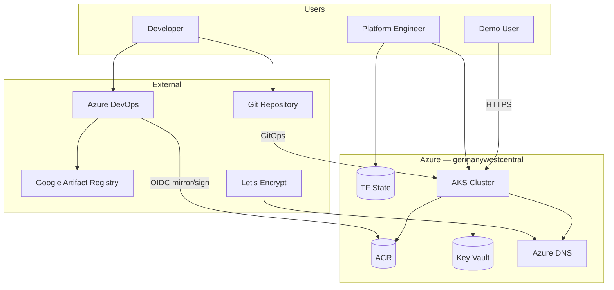
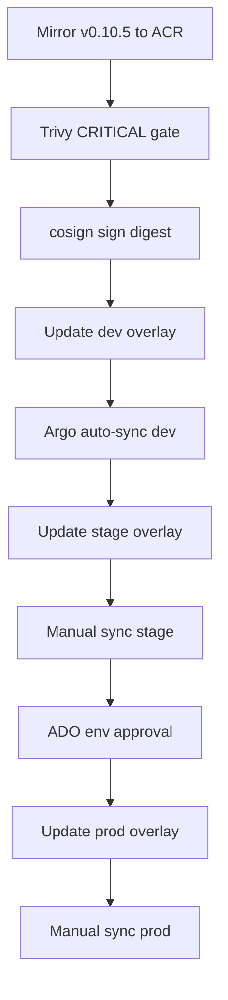

# Architecture — boutique-aks-devsecops

**Status:** Production reference closed. Setup Topics **00–13** ran end to end, then Azure resources from that run were destroyed. There is no live AKS, ACR, or Key Vault from the reference.
**Maturity:** Production reference — one subscription, one AKS cluster — decommissioned
**Region:** `germanywestcentral` (when rebuilt)
**Application:** Online Boutique [v0.10.5](https://github.com/GoogleCloudPlatform/microservices-demo/releases/tag/v0.10.5)

[Project README](README.md) · [Doc index](docs/README.md) · [Deep architecture](docs/architecture/README.md) · [Setup](docs/setup/README.md) · [Roadmap](ROADMAP.md) · [Reference claims](docs/reference-claims.md)

---

## How to read this document

| If you want… | Stay here for… | Then open… |
|--------------|----------------|------------|
| A 10-minute picture | Executive summary, diagrams, tradeoffs | [ADR-0005](docs/adr/0005-cosign-key-based-signing.md) |
| Design and delivery detail | Mapping table and deep-dive index | [`docs/architecture/`](docs/architecture/README.md) — especially [05-deployment-flow](docs/architecture/05-deployment-flow.md), [07-security-architecture](docs/architecture/07-security-architecture.md) |
| Evidence without a cluster | — | [`docs/reference-claims.md`](docs/reference-claims.md) |
| Rebuild | Component → setup mapping (orientation only) | [`docs/setup/README.md`](docs/setup/README.md) |

This file is the architecture summary. Numbered pages under [`docs/architecture/`](docs/architecture/README.md) are the deep reference. Setup steps live only under [`docs/setup/`](docs/setup/README.md).

---

## Executive summary

This repository delivers Online Boutique on Azure AKS with a signed supply chain and GitOps. Azure DevOps mirrors Boutique **v0.10.5** into ACR, fails the job on CRITICAL findings, cosign-signs digests, and commits those digests into Git. Argo CD reconciles desired state from GitHub. **Unsigned or floating tags should not reach the cluster.** Kyverno enforces that for Boutique workloads.

`dev`, `stage`, and `prod` are namespaces on one cluster — cost over blast-radius isolation. Prod promotion needs an ADO environment approval and a manual Argo sync. Secrets stay in Key Vault (CSI + Workload Identity). Metrics and logs stay on-cluster (Prometheus, Loki, Grafana). After validation, the reference was torn down — see [Setup Topic 13](docs/setup/13-teardown.md).

Claims you can check without a cluster: [`docs/reference-claims.md`](docs/reference-claims.md). Landing-page tradeoffs: [README](README.md#tradeoffs--what-i-would-change-for-real-production).

Version pins: [versions.yaml](versions.yaml). Maintainer plan: [docs/implementation/plan.md](docs/implementation/plan.md).

---

## 1. Requirements

### Functional

| ID | Requirement | Architectural implication |
|----|-------------|---------------------------|
| FR-01 | Terraform: RG, remote state, VNet, NSG, Azure DNS `biroltilki.art` | `terraform/bootstrap/`, `terraform/environments/dev/`, networking + dns modules |
| FR-02 | AKS + WI, ACR, Key Vault, Entra RBAC, kubelet AcrPull, ADO OIDC | `terraform/modules/{aks,acr,key-vault,identities,ado-federation}/` |
| FR-03 | GitOps platform: Argo CD, NGINX, cert-manager, CSI, Kyverno, monitoring | `gitops/bootstrap/`, `gitops/platform/`, `policies/` |
| FR-04 | ADO: mirror, Trivy gate, cosign sign, digest GitOps promotion | `pipelines/` → `gitops/apps/boutique/overlays/` |

### Non-functional

| Category | Requirement | Reference |
|----------|-------------|-----------|
| Security | Least privilege; no secrets in Git; signed images | [07-security-architecture.md](docs/architecture/07-security-architecture.md) |
| Observability | Metrics, dashboards, alerts, SLO | [10-observability.md](docs/architecture/10-observability.md) |
| Cost | One cluster; teardown destroys ACR | [11-cost-model.md](docs/architecture/11-cost-model.md) |
| Reproducibility | Pinned `versions.yaml`; remote TF state | Setup Topic 01 bootstrap |

See [01-requirements.md](docs/architecture/01-requirements.md).

---

## 2. Constraints

| Constraint | Design impact |
|------------|---------------|
| Azure only | `azurerm` provider; Azure-native identity and secrets |
| One AKS cluster | Namespace isolation for dev/stage/prod |
| Budget minimal | `Standard_D2s_v6` system + `Standard_D4s_v6` user pool |
| No long-lived CI secrets | ADO OIDC federation |
| Destroy ACR on teardown | Roadmap Phase 14 / Setup Topic 13 removes mirrored images |

---

## 3. Assumptions

| Assumption | Validate in |
|------------|-------------|
| Azure subscription admin | Setup Topic 00 |
| DNS `biroltilki.art` delegatable to Azure DNS | Setup Topic 02 |
| Dsv6 SKUs available in `germanywestcentral` | Setup Topics 00 and 03 (`az vm list-skus`) |
| ADO federation rights | Setup Topic 04 |

---

## 4. High-level architecture

Terraform provisions the VNet, AKS (Workload Identity), ACR, Key Vault, and Azure DNS. Logs stay in-cluster with Loki ([ADR-0012](docs/adr/0012-loki-in-cluster-logging.md)). Log Analytics stays off on the default reference path.

Argo CD reconciles platform charts and Boutique overlays from `gitops/`. ADO mirrors, scans, and signs images, then updates digests in Git. Kyverno enforces the ACR allowlist, denies `:latest`, verifies signatures, and applies a Pod Security baseline. NGINX Ingress and cert-manager expose five HTTPS hostnames with Let's Encrypt DNS-01.

### Layers

| Layer | Components | Repo path |
|-------|------------|-----------|
| Infrastructure | VNet, AKS, ACR, KV, DNS | `terraform/` |
| Logging | Loki + Promtail (in-cluster) | `gitops/platform/monitoring/` |
| Platform | Argo CD, NGINX, cert-manager, CSI, Kyverno, monitoring | `gitops/platform/` |
| Applications | Online Boutique v0.10.5 | `gitops/apps/boutique/` |
| Policy | Kyverno cluster policies | `policies/` |
| CI/CD | ADO mirror/scan/sign/promote | `pipelines/` |

### Environments (one cluster)

| Env | Namespace | Hostname | Argo sync | Prod gate |
|-----|-----------|----------|-----------|-----------|
| dev | `boutique-dev` | `dev-boutique.biroltilki.art` | Auto | — |
| stage | `boutique-stage` | `stage-boutique.biroltilki.art` | Manual | — |
| prod | `boutique-prod` | `boutique.biroltilki.art` | Manual | **ADO environment approval** |

### Node pools (locked)

| Pool | VM SKU | vCPU / RAM |
|------|--------|------------|
| System | `Standard_D2s_v6` | 2 / 8 GiB |
| User | `Standard_D4s_v6` | 4 / 16 GiB (autoscaler 1–3) |

---

## 5. Component diagram

Engineers provision with Terraform and operate via GitOps. Pipelines mirror Google public images into private ACR, scan and sign, then update Git. Users reach Boutique and platform UIs through NGINX on a shared ingress.

Full diagram: [03-component-design.md](docs/architecture/03-component-design.md).

---

## 6. Data flows

| Flow | Document |
|------|----------|
| Application requests | [04-data-flows.md](docs/architecture/04-data-flows.md) |
| GitOps / supply chain | [04-data-flows.md](docs/architecture/04-data-flows.md) |
| Telemetry | [10-observability.md](docs/architecture/10-observability.md) |
| Secrets (KV → CSI) | [07-security-architecture.md](docs/architecture/07-security-architecture.md) |

---

## 7. Deployment flow

Details: [05-deployment-flow.md](docs/architecture/05-deployment-flow.md).

---

## 8. Network

One VNet hosts the AKS subnet. Azure CNI is in use. A single NGINX Load Balancer serves five hostnames on the same ingress IP. Outbound traffic uses AKS managed egress. Details: [06-network-design.md](docs/architecture/06-network-design.md).

---

## 9. Security boundaries

| Zone | Controls |
|------|----------|
| Internet | TLS at ingress |
| Cluster edge | cert-manager, ingress rules |
| Admission | Kyverno verifyImages + PSS baseline |
| Secrets | Key Vault + CSI + Workload Identity |
| CI | OIDC; no secrets in Git |

Details: [07-security-architecture.md](docs/architecture/07-security-architecture.md).

---

## 10. Failure scenarios

| Scenario | Mitigation |
|----------|------------|
| Node loss | ReplicaSets; cluster autoscaler |
| GitOps desync | Argo CD UI; manual sync/rollback |
| Unsigned image deploy | Kyverno deny |
| cert-manager failure | DNS-01 troubleshooting runbook |
| TF state lock | Blob versioning; break lease procedure |

Full table: [08-resilience-and-dr.md](docs/architecture/08-resilience-and-dr.md).

---

## 11. Scalability

The user pool autoscales from 1 to 3 nodes (`Standard_D4s_v6`). Three full Boutique namespaces is the designed ceiling for this reference. The lived test often ran a slim Boutique (core storefront only) to stay within pod capacity. The usual bottleneck is node CPU and maxPods; mitigate with the autoscaler and optional HPA on the frontend.

---

## 12. Disaster recovery

Rebuild from Git and Terraform takes about 4–8 hours (RTO). With blob versioning, Terraform state RPO is effectively zero; the Redis cart is ephemeral. Multi-region is out of scope. Rebuild order: [08-resilience-and-dr.md](docs/architecture/08-resilience-and-dr.md).

---

## 13. Observability

The stack is kube-prometheus-stack (Prometheus, Grafana, Alertmanager), Loki/Promtail, and a baseline OTel collector. Grafana was at `grafana-boutique.biroltilki.art` when the reference was live. Logging stays in-cluster ([ADR-0012](docs/adr/0012-loki-in-cluster-logging.md)). Details: [10-observability.md](docs/architecture/10-observability.md).

---

## 14. Cost

Expect about €150–250/month with two nodes active. Teardown (Roadmap Phase 14 / Setup Topic 13) destroys ACR and AKS. Details: [11-cost-model.md](docs/architecture/11-cost-model.md).

---

## 15. Tradeoffs

| Decision | Chosen | Alternative | Cost of choice |
|----------|--------|-------------|----------------|
| Single cluster | 3 namespaces | Multi-cluster | Shared blast radius |
| Kyverno only | Admission in-cluster | Azure Policy | No subscription K8s policy |
| Key-based cosign 2.2.x | `--tlog-upload=false` | Keyless Fulcio | Key rotation duty |
| Mirror upstream | Pull v0.10.5 | Build from source | Less custom CI demo |
| Destroy ACR on teardown | Clean cost stop | Retain images | Re-mirror on rebuild |

---

## 16. Future enhancements

| Item | Prerequisite |
|------|--------------|
| Entra SSO for Argo CD | Entra app registration |
| Trivy vuln attestations | Stretch (SPDX SBOM attestations: [ADR-0014](docs/adr/0014-sbom-cosign-attestations.md)) |
| Service mesh | Stable baseline |
| NetworkPolicy default deny | Optional after rebuild (`base/networkpolicies/`); enforce via `aks_network_policy=azure` |

See [ROADMAP.md](ROADMAP.md). Full ADR list: [docs/architecture/README.md](docs/architecture/README.md#architecture-decision-records) · [docs/adr/README.md](docs/adr/README.md).

---

## Component → repo → setup

| Component | Repo path | Setup topic |
|-----------|-----------|-------------|
| Remote state | `terraform/bootstrap/` | 01-terraform-bootstrap |
| VNet, DNS | `terraform/modules/networking/`, `dns/` | 02-azure-foundation |
| AKS, ACR, KV | `terraform/modules/aks/`, `acr/`, `key-vault/` | 03-cluster-resources |
| ADO OIDC | `terraform/modules/ado-federation/` | 04-ado-oidc |
| Argo CD | `gitops/bootstrap/` | 05-gitops-bootstrap |
| Ingress + TLS | `gitops/platform/ingress-nginx/`, `cert-manager/` | 06-ingress-tls |
| CSI | `gitops/platform/secrets-store-csi/` | 07-secrets-csi |
| Kyverno | `gitops/platform/kyverno/`, `policies/` | 08-admission-policies |
| CI | `pipelines/` | 09-ci-pipeline |
| Boutique | `gitops/apps/boutique/` | 10-boutique-dev, 12-promotion |
| Monitoring | `gitops/platform/monitoring/` | 11-observability |
| Teardown | `scripts/operations/teardown.sh` | 13-teardown |
