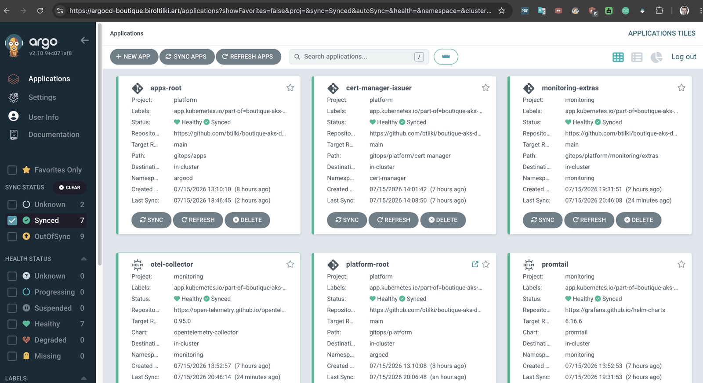
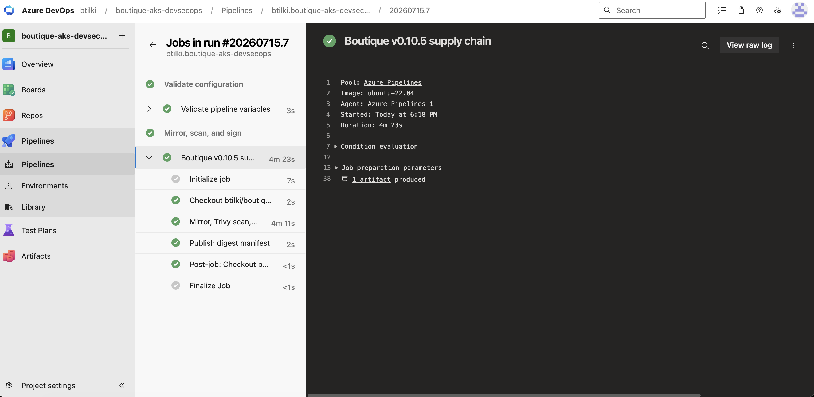
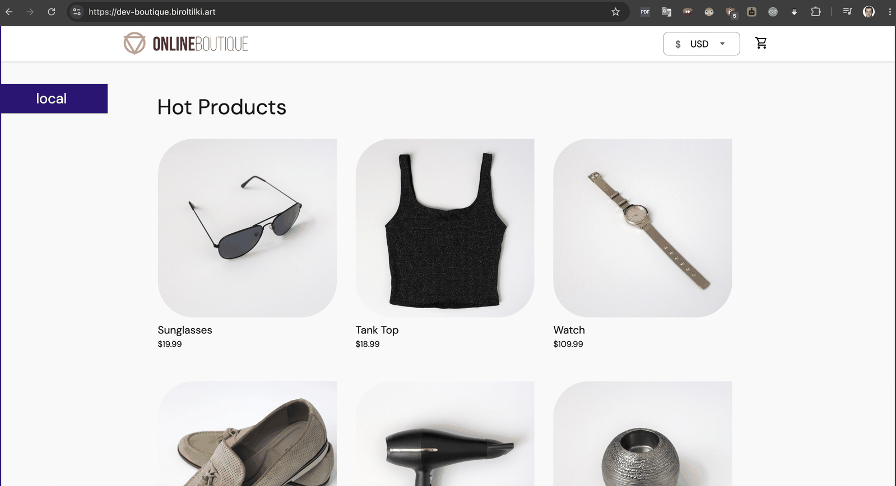
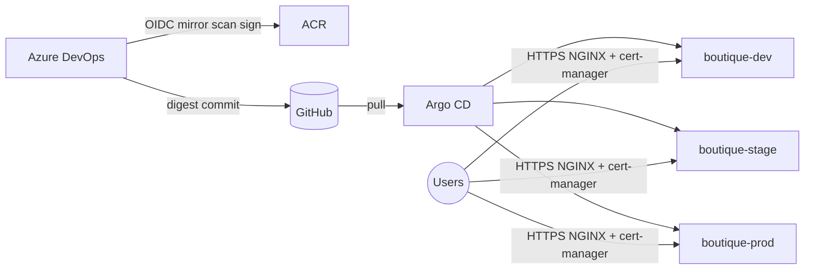
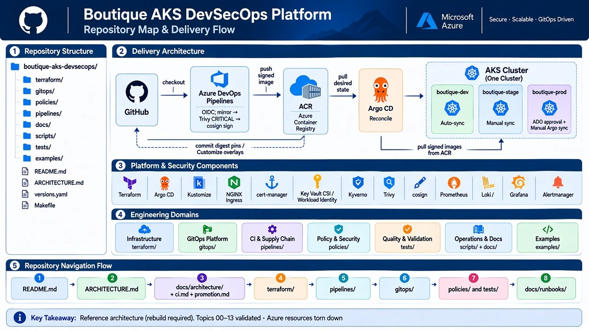

# boutique-aks-devsecops

Production-pilot Azure DevSecOps for Online Boutique **v0.10.5** on AKS — signed digests, Kyverno admission, GitOps promotion.

> **Status:** Production pilot closed. Setup Topics **00–13** ran end to end; then the Azure resources were destroyed. There is no live AKS, ACR, or Key Vault from that run. To run again, follow [`docs/setup/`](docs/setup/).

---

## Problem

Mutable tags and unsigned images make “what is running?” hard to trust. Long-lived CI secrets and a pipeline that can push straight into the cluster create a second deploy authority next to Git. A demo that only shows Terraform apply does not prove the supply-chain path.

## Decision

- **Mirror, scan, sign, promote by digest** — Azure DevOps mirrors Boutique v0.10.5 into ACR, fails on CRITICAL findings, cosign-signs digests, then updates GitOps overlays ([ADR-0005](docs/adr/0005-cosign-key-based-signing.md)).
- **Admission blocks the easy mistakes** — Kyverno allows only ACR, denies `:latest`, and verifies signatures on Boutique workloads.
- **Git is what Argo CD reconciles** — GitHub holds desired state; ADO uses OIDC to Azure (no long-lived pipeline secrets). Prod promotion needs an ADO environment approval.
- **One AKS cluster, three namespaces** — cost over blast-radius isolation.

## Result

Topics **00–13** completed, then teardown. Cost when active was roughly €150–250/month; teardown destroys ACR, so a rebuild must re-mirror. File-backed claims: [`docs/pilot-claims.md`](docs/pilot-claims.md).

---

## At a glance

| | |
|-|-|
| What | DevSecOps on one AKS cluster in `germanywestcentral` |
| Hard rule | **Unsigned or floating tags should not reach the cluster** |
| CI model | GitHub = source of truth · Azure DevOps = pipelines (OIDC) · no GitHub Actions |
| Scope | Production pilot — one subscription, one region; not multi-region HA |
| Stack | Terraform · AKS · ACR · Key Vault · Argo CD · Kyverno · Trivy · cosign · Prometheus / Loki / Grafana |

---

## Proof

These screenshots are from the lived run. Full catalog: [`assets/images/README.md`](assets/images/README.md). Hostnames stay offline until you rebuild.

**Argo CD** — Applications Healthy/Synced:



**Azure DevOps** — supply-chain pipeline green (mirror → Trivy → cosign):



**Storefront** — `dev-boutique.biroltilki.art` over HTTPS (when the pilot was live):



More: ACR digests, Grafana, stage/prod storefronts — [`assets/images/setup/`](assets/images/setup/). Claims without a live cluster: [`docs/pilot-claims.md`](docs/pilot-claims.md).

---

## Tradeoffs / what I would change for real production

- **Single cluster, three namespaces** — fine for a cost-capped pilot; not true env isolation. Separate clusters (or subscriptions) for prod.
- **Public API server, system pool size 1, no availability zones** — rebuild would tighten API access and HA first.
- **Trivy CRITICAL with `--ignore-status fixed`** — upstream v0.10.5 is mirrored, not rebuilt; fixed CVEs can still appear in the image.
- **Cosign key passphrase empty; transparency log off** — Key Vault RBAC protects the key; a client path would use a passphrase or keyless signing and Rekor.
- **Signature verify skips platform namespaces** — Boutique is gated; platform charts are a second trust domain.

Do **not** call this production-ready. The namespace named `prod` is a promotion stage on the same cluster. Public-share rules: [CONTRIBUTING.md](CONTRIBUTING.md#public-share-hygiene).

---

## Where to start

| I want to… | Read |
|------------|------|
| Understand the project in ~10 minutes | This page → [`ARCHITECTURE.md`](ARCHITECTURE.md) → [ADR-0005](docs/adr/0005-cosign-key-based-signing.md) |
| See pilot proof | [`docs/pilot-claims.md`](docs/pilot-claims.md) · [`assets/images/`](assets/images/README.md) |
| Review design and delivery | [`docs/architecture/`](docs/architecture/README.md) · [`docs/ci.md`](docs/ci.md) · [`docs/promotion.md`](docs/promotion.md) · [`docs/rollback.md`](docs/rollback.md) · [`docs/security/threat-model.md`](docs/security/threat-model.md) |
| Rebuild or operate | [`docs/setup/`](docs/setup/README.md) (Topics 00–13) · [`versions.yaml`](versions.yaml) · [`docs/runbooks/`](docs/runbooks/README.md) |

Full index: [`docs/README.md`](docs/README.md)

---

## Supply-chain flow (summary)



Promotion: `dev → stage → prod` (same digest; **ADO approval before prod**). Details: [`docs/architecture/05-deployment-flow.md`](docs/architecture/05-deployment-flow.md).

---

## Repository map and navigation

This map shows repository layout, platform components, and where each engineering area lives.



---

## What the pilot demonstrated

- Terraform foundation: VNet, AKS (Workload Identity), ACR, Key Vault, Azure DNS, ADO OIDC
- Argo CD app-of-apps; NGINX + cert-manager; Key Vault CSI; Kyverno Enforce for allowlist, deny `:latest`, and signature verify on Boutique
- ADO: mirror → Trivy → cosign → digest promotion; Grafana + in-cluster Loki
- Ordered teardown after validation (see [`docs/setup/13-teardown.md`](docs/setup/13-teardown.md))

---

## Technology stack

| Area | Choices |
|------|---------|
| Cloud / region | Azure `germanywestcentral` |
| IaC | Terraform ≥ 1.6 |
| Kubernetes | AKS, Azure CNI |
| GitOps / delivery | Argo CD, Kustomize overlays |
| Policy / secrets | Kyverno, Secrets Store CSI, Key Vault |
| Ingress / TLS | NGINX Ingress, cert-manager, Let's Encrypt DNS-01 |
| CI / supply chain | Azure DevOps, ACR, Trivy, cosign |
| Observability | kube-prometheus-stack, Loki, Promtail, Grafana |

Pins: [`versions.yaml`](versions.yaml) · Deep design: [`docs/architecture/README.md`](docs/architecture/README.md)

---

## Repository layout

```text
boutique-aks-devsecops/
├── terraform/    # Azure IaC (bootstrap, modules, environments/dev)
├── gitops/       # Argo CD bootstrap, platform, Boutique overlays
├── policies/     # Kyverno cluster policies and tests
├── pipelines/    # Azure DevOps CI (not GitHub Actions)
├── docs/         # Architecture, setup, security, runbooks
├── scripts/      # Guarded helpers (teardown, OIDC verify)
├── tests/        # Terraform, policy, integration validation
└── examples/     # Runnable demos (CSI secret test)
```

---

## Quick clone

```bash
git clone https://github.com/btilki/boutique-aks-devsecops.git
cd boutique-aks-devsecops
```

Do not provision Azure from this file. Bootstrap and destroy live under [`docs/setup/`](docs/setup/).

---

## Contributing · License · References

- Contributing: [`CONTRIBUTING.md`](CONTRIBUTING.md)
- Security: [`SECURITY.md`](SECURITY.md)
- Changelog: [`CHANGELOG.md`](CHANGELOG.md)
- Roadmap: [`ROADMAP.md`](ROADMAP.md)

Licensed under Apache License 2.0 — see [`LICENSE`](LICENSE). Upstream app: [Google Online Boutique](https://github.com/GoogleCloudPlatform/microservices-demo).

Stack references: [Argo CD](https://argo-cd.readthedocs.io/) · [Kyverno](https://kyverno.io/) · [cosign](https://docs.sigstore.dev/) · [Trivy](https://trivy.dev/) · [Azure AKS](https://learn.microsoft.com/azure/aks/)
