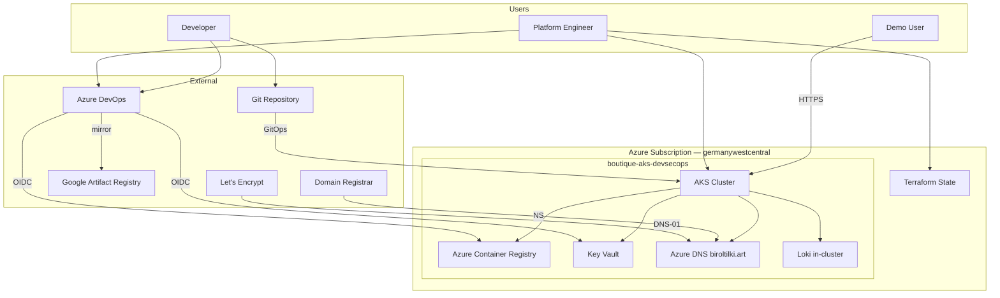

# System context

Who touches the platform, which external systems it depends on, and how traffic and supply chain cross the Azure boundary.

## Actors

| Actor | Interactions |
|-------|--------------|
| Platform engineer | Terraform, kubectl, Argo CD, Azure Portal |
| Developer | Git push, ADO pipeline runs |
| Demo user | HTTPS to Boutique hostnames |
| Let's Encrypt | DNS-01 challenges against Azure DNS |
| Google Artifact Registry | Read-only pull for mirror pipeline |

## External dependencies

| System | Purpose | Failure impact |
|--------|---------|----------------|
| Azure subscription | Hosts all infrastructure | Total outage |
| Domain registrar | NS delegation to Azure DNS | TLS issuance blocked |
| Azure DevOps | CI/CD, prod approval gate | No new images/promotions |
| Google sample images | Boutique v0.10.5 source | Mirror pipeline blocked |

## Context diagram

The platform runs in one Azure region. Git holds desired state; ADO builds, signs, and promotes; Google public images are upstream only until mirrored. The registrar delegates DNS. Runtime pulls never hit Google — only signed images from ACR after mirror/sign.
