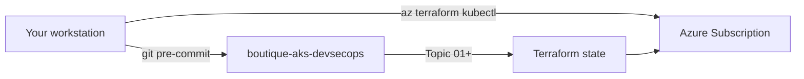

# 00 — Prerequisites

Audience: Implementer
Estimated time: ~60 minutes
Prerequisites: None
Related: [Setup index](README.md) · [ARCHITECTURE.md](../../ARCHITECTURE.md) · [versions.yaml](../../versions.yaml) · [ADR-0011](../adr/0011-aks-node-vm-sku.md)

> No live cluster from the closed reference. Azure resources were destroyed after Setup Topic 13 (teardown). This topic checks your machine and accounts only — it does not create AKS or other billable Azure resources. Full setup index: [setup README](README.md).

---

## Purpose

Prepare your workstation and Azure access for Topics 01+. Exit criteria: supported CLI versions, logged-in subscription, D2s_v6/D4s_v6 availability in `germanywestcentral`, GitHub `origin`, and passing pre-commit.

## When to use

Use this guide once before [01-terraform-bootstrap.md](01-terraform-bootstrap.md), and again when:

- Setting up a new laptop
- Switching Azure subscriptions
- Returning after a long break (re-run the validation section only)

Do not use this guide for day-2 cluster operations — see [docs/operations/](../operations/) and [docs/runbooks/](../runbooks/).

## Prerequisites

- macOS, Linux, or WSL2 on Windows
- Internet access for package installs and Azure CLI login
- An Azure subscription where you can create resource groups (Owner or Contributor)
- Rights to register Azure DNS and create AKS resources (validated in later topics)
- Git installed
- A GitHub account with permission to create repositories (or access to an existing org repo)
- This project directory on your machine (cloned from GitHub or copied locally — Step 4 connects Git either way)

Required knowledge: basic shell, Git, and cloud CLI usage. No prior AKS experience required.

Version control: GitHub is the sole Git remote (Argo CD, ADO, promotion). Azure DevOps is CI and OIDC only. Connect `origin` in Step 4; patch `<GITHUB_ORG>` / `<REPO_NAME>` in GitOps YAML in Topics 05–12.

## Architecture context

One AKS platform in `germanywestcentral` (`Standard_D2s_v6` system, `Standard_D4s_v6` user pools) with versions pinned in [versions.yaml](../../versions.yaml). Your workstation drives every CLI step from Topic 01 — no pre-provisioned cluster.



---

## Step-by-step implementation

### Step 1: Install core CLI tools

Goal: Install Terraform, Azure CLI, kubectl, Helm, Git, Python 3, and pre-commit at the minimum supported versions.

Why: Later topics run `terraform apply`, `az aks get-credentials`, `helm`, and pre-commit hooks. Version skew causes provider and API errors.

Where: Your local machine (not Azure Cloud Shell for day-to-day work).

#### macOS (Homebrew)

```bash
brew install terraform azure-cli kubectl helm git python@3.12 pre-commit
```

#### Linux (apt example — adjust for your distro)

```bash
sudo apt-get update
sudo apt-get install -y git python3 python3-pip curl
curl -sL https://aka.ms/InstallAzureCLIDeb | sudo bash
# Install Terraform from HashiCorp repo per https://developer.hashicorp.com/terraform/install
pip install pre-commit
```

#### Verify versions

```bash
terraform version
az version
kubectl version --client
helm version
git --version
python3 --version
pre-commit --version
```

Expected: each command prints a version. Minimums from [versions.yaml](../../versions.yaml):

| Tool | Minimum |
|------|---------|
| Terraform | >= 1.6.0 |
| kubectl client | 1.34+ (within one minor of AKS — see `versions.yaml`) |
| Helm | 3.14+ |
| Python | 3.10+ |
| pre-commit | 3.0+ |

Validation:

- [ ] `terraform version` shows `>= 1.6`
- [ ] `kubectl version --client` shows 1.34 or higher (or within one minor of `versions.yaml`)
- [ ] All commands exit with code 0

---

### Step 2: Authenticate to Azure and select subscription

Goal: Log in with Azure CLI and set the subscription used for the whole project.

Why: Every `az` and Terraform command targets one subscription. The wrong subscription puts resources in the wrong tenant or billing scope.

Where: Local machine.

```bash
az login
az account list --output table
az account set --subscription "<AZURE_SUBSCRIPTION_ID>"
az account show --output table
```

Replace `<AZURE_SUBSCRIPTION_ID>` with your subscription GUID from `az account list`.

Expected: `az account show` displays the chosen subscription name and `IsDefault: True`.

Validation:

```bash
az account show --query "{name:name, id:id, tenantId:tenantId}" -o json
```

- [ ] Subscription ID matches the one you intend to bill
- [ ] You have Contributor or Owner on this subscription (Azure Portal → Subscriptions → Access control)

Common problems:

| Symptom | Fix |
|---------|-----|
| `az login` opens browser but fails | Clear cache: `az account clear` then retry |
| Subscription not listed | Sign in with the correct Entra tenant; ask an admin for access |
| `AuthorizationFailed` later | Confirm RBAC on the subscription or resource group |

---

### Step 3: Verify VM SKU availability in `germanywestcentral`

Goal: Confirm `Standard_D4s_v6` (user pool) and `Standard_D2s_v6` (system pool) are available for your subscription in `germanywestcentral`.

Why: AKS node pool creation fails if the SKU is restricted or capacity-blocked. This check avoids a failed Topic 03 apply. See [ADR-0011](../adr/0011-aks-node-vm-sku.md).

Where: Local machine (Step 2 complete).

```bash
az vm list-skus --location germanywestcentral --size Standard_D4s_v6 --all -o table
az vm list-skus --location germanywestcentral --size Standard_D2s_v6 --all -o table
```

Expected: rows with the `Restrictions` column empty or showing `None`:

```text
ResourceType     Locations           Name             Zones    Restrictions
---------------  ------------------  ---------------  -------  --------------
virtualMachines  GermanyWestCentral  Standard_D4s_v6  1,2,3    None
```

Validation:

- [ ] Both D4s_v6 and D2s_v6 show no `NotAvailableForSubscription` restriction
- [ ] If restricted, do not proceed to Topic 03 without a fallback SKU documented in ADR-0011

Recovery: If other regions are restricted but `germanywestcentral` is clear, keep the locked region. Do not change region without updating `versions.yaml` and ADR-0011.

---

### Step 4: Connect local project to GitHub

Goal: Make the project a Git repository with `origin` on GitHub and an initial commit on `main`.

Why: Pre-commit (Step 5), PRs, and later GitOps topics need a pushable remote. Without Git and `origin`, `pre-commit install` fails and Topics 05–12 cannot sync from Git.

Where: Local machine (repository root) and GitHub (browser or `gh` CLI).

Replace placeholders:

| Placeholder | Meaning | Example |
|-------------|---------|---------|
| `<GITHUB_ORG>` | Your GitHub user or organization | `biroltilki` |
| `<REPO_NAME>` | Repository name | `boutique-aks-devsecops` |
| `<GITHUB_REPO_URL>` | HTTPS clone URL | `https://github.com/biroltilki/boutique-aks-devsecops.git` |

#### Step 4.1: Choose your path

| Situation | Path |
|-----------|------|
| Empty folder — want a fresh clone | Path A — clone from GitHub |
| Project files already on disk (no `.git`) | Path B — init local, create GitHub repo, push |
| Already cloned with a working `origin` | Path C — verify only |

---

#### Path A — Clone from an existing GitHub repository

Use when the repo already exists on GitHub (yours or a fork).

```bash
cd ~/Documents/Cursor   # or your preferred parent directory
git clone https://github.com/<GITHUB_ORG>/<REPO_NAME>.git
cd <REPO_NAME>
git status
git remote -v
git branch --show-current
```

Expected: `origin` matches your GitHub repo; branch is `main` (or `git checkout main`).

---

#### Path B — Local project exists; create GitHub repo and connect

Use when you already have project files locally but no Git remote yet.

B.1 — Verify local directory

```bash
cd /path/to/boutique-aks-devsecops
ls README.md docs/setup/00-prerequisites.md versions.yaml
git status
```

If `git status` prints `fatal: not a git repository`, initialize Git:

```bash
git init -b main
git status
```

B.2 — Create an empty GitHub repository (GUI)

1. Sign in to [GitHub](https://github.com)
2. Click + (top right) → New repository
3. Owner: `<GITHUB_ORG>`
4. Repository name: `<REPO_NAME>` (e.g. `boutique-aks-devsecops`)
5. Description (optional): Azure AKS DevSecOps production reference
6. Visibility: Private recommended (reduces exposure; still never put secrets in Git)
7. Do not initialize with README, `.gitignore`, or license — your local tree already has these
8. Click Create repository
9. Copy the HTTPS URL (e.g. `https://github.com/<GITHUB_ORG>/<REPO_NAME>.git`)

B.3 — Connect remote and push

```bash
cd /path/to/boutique-aks-devsecops

# Confirm secrets are not staged
git status
# terraform.tfvars must NOT appear — it is gitignored

git remote add origin https://github.com/<GITHUB_ORG>/<REPO_NAME>.git
# If origin already exists with wrong URL: git remote set-url origin <GITHUB_REPO_URL>

git add .
git status
# Review: no terraform.tfvars, no *.pem, no .env files

git commit -m "chore: initial commit — boutique-aks-devsecops scaffold"
git push -u origin main
```

Authentication: GitHub does not accept account passwords for HTTPS push. Use one of:

- GitHub CLI (recommended): `gh auth login`, then push
- PAT: create at GitHub → Settings → Developer settings → Fine-grained token (Contents: Read and write)
- SSH: `git remote set-url origin git@github.com:<GITHUB_ORG>/<REPO_NAME>.git` with an SSH key

B.4 — Optional: create the repo with GitHub CLI

If [`gh`](https://cli.github.com/) is installed and authenticated:

```bash
cd /path/to/boutique-aks-devsecops
gh auth login
gh repo create <REPO_NAME> --private --source=. --remote=origin --push
```

Skip B.2–B.3 if this succeeds.

---

#### Path C — Verify existing clone

```bash
cd /path/to/boutique-aks-devsecops
git status
git remote -v
git branch --show-current
git log -1 --oneline
```

Expected:

```text
origin  https://github.com/<GITHUB_ORG>/<REPO_NAME>.git (fetch)
origin  https://github.com/<GITHUB_ORG>/<REPO_NAME>.git (push)
main
```

---

#### Step 4 validation

```bash
git remote get-url origin
git status
git branch --show-current
```

- [ ] `git status` works (not `fatal: not a git repository`)
- [ ] `origin` points to your GitHub HTTPS or SSH URL
- [ ] Branch is `main`
- [ ] At least one commit exists locally (`git log -1`)
- [ ] `git push origin main` succeeds (Path B) or the repo is up to date (Path A/C)
- [ ] GitHub web UI shows repository files (README, `docs/setup/`, `terraform/`)

Common problems:

| Symptom | Fix |
|---------|-----|
| `fatal: not a git repository` | Path B: run `git init -b main` |
| `remote origin already exists` | `git remote -v` — use `set-url` if wrong |
| `Support for password authentication was removed` | Use a PAT, `gh auth login`, or SSH |
| `terraform.tfvars` in `git status` | Do not commit — check `.gitignore`; `git reset HEAD terraform.tfvars` |
| Large file rejected on push | Check the large-file hook limit; remove binaries from the commit |
| Empty GitHub repo has a template README | Prefer Path B step 7 (empty repo); otherwise delete or merge the template README |

---

### Step 5: Install pre-commit hooks

Goal: Install Git hooks so commits run gitleaks, Terraform fmt, and YAML lint automatically.

Why: Catches secrets and formatting issues before review. Requires Step 4 (`.git/` must exist).

Where: Local machine, repository root.

```bash
cd /path/to/boutique-aks-devsecops
pre-commit install
pre-commit run --all-files
```

Expected: hooks run; `terraform_validate` should pass on existing modules. `gitleaks`, `trailing-whitespace`, and `yamllint` should pass on existing docs.

Validation:

- [ ] `pre-commit install` prints `pre-commit installed at .git/hooks/pre-commit`
- [ ] `pre-commit run --all-files` completes without unexpected failures

Common problems:

| Symptom | Fix |
|---------|-----|
| `pre-commit install` fails — not a git repo | Complete Step 4 first |
| `terraform validate` fails | Paste the error — you may need `terraform init` in `terraform/bootstrap` or `terraform/environments/dev` |
| `yamllint` errors | Fix the reported lines or run from the repo root |
| `gitleaks` false positive | Review the match; never commit real secrets to “test” the hook |

---

### Step 6: Install optional tools (recommended before Topics 08–09)

Goal: Pre-install tools used later so pipeline and policy topics are not blocked.

Why: Not required for Topic 01, but installing early avoids mid-project context switching.

Where: Local machine.

| Tool | Used in | Install hint |
|------|---------|--------------|
| cosign 2.2.4 | Topic 09 sign/verify | `brew install cosign` or [sigstore releases](https://github.com/sigstore/cosign/releases) |
| Trivy | Topic 09 scan | `brew install trivy` (pin to [versions.yaml](../../versions.yaml)) |
| kustomize | Topic 10 overlays | `brew install kustomize` |
| Kyverno CLI | Topic 08 policy tests | `brew install kyverno` |

```bash
cosign version
trivy --version
kustomize version
kyverno version
```

Validation: optional at Topic 00 — note which tools you installed for later.

---

## Validation (end-to-end)

Run this checklist before [01-terraform-bootstrap.md](01-terraform-bootstrap.md):

```bash
terraform version
az account show --query name -o tsv
az vm list-skus --location germanywestcentral --size Standard_D4s_v6 --all -o table | head -5
git remote -v
git status
pre-commit run --all-files
```

- [ ] All core CLI tools meet minimum versions
- [ ] Correct Azure subscription selected
- [ ] VM SKUs available in `germanywestcentral`
- [ ] GitHub `origin` configured; `main` branch pushed
- [ ] Pre-commit hooks installed and passing
- [ ] You have read the [ARCHITECTURE.md](../../ARCHITECTURE.md) executive summary and the [ROADMAP.md](../../ROADMAP.md) phase overview

---

## Troubleshooting

| Symptom | Likely cause | Fix |
|---------|--------------|-----|
| `az: command not found` | CLI not installed or not on PATH | Reinstall Azure CLI; restart the shell |
| `kubectl` connects to the wrong cluster | Old kubeconfig context | Topic 03 sets the correct context; for now `kubectl config get-contexts` |
| SKU list empty | Wrong region name | Use `germanywestcentral` exactly (no spaces) |
| SKU `NotAvailableForSubscription` | Regional or subscription quota | Try ADR-0011 fallbacks; request a quota increase in Azure Portal |
| pre-commit fails on `terraform validate` | Provider plugins not initialized | Run `terraform init` in `terraform/bootstrap` or `terraform/environments/dev` (not under `modules/`); paste the error if it persists |
| `git push` rejected (403/401) | GitHub auth | `gh auth login`, or configure a PAT / SSH key |
| `origin` missing | Step 4 skipped | `git remote add origin <GITHUB_REPO_URL>` |
| `az login` tenant mismatch | Multiple Entra tenants | `az login --tenant <TENANT_ID>` |

---

## Common mistakes

- Using Azure Cloud Shell as your only environment — fine for quick checks; keep Terraform and kubeconfig workflows on your primary machine.
- Skipping the SKU check — Topic 03 `terraform apply` fails late with allocation errors.
- Committing `terraform.tfvars` with secrets — use `*.tfvars.example` only; real values stay local or in CI / OIDC.
- Skipping the GitHub remote — pre-commit and GitOps topics fail without `.git` and a pushable `origin`.
- Initializing the GitHub repo with a README when local files already exist — causes unrelated histories on first push; create an empty repo (Path B).
- Wrong region — keep everything in `germanywestcentral` unless ADR-0011 is updated.

---

## Best practices

- Pin your active subscription in a shell alias to avoid cross-subscription applies.
- Re-run Step 3 if Azure reports capacity issues in your region.
- Run `pre-commit run --all-files` before every PR.
- Keep [versions.yaml](../../versions.yaml) open when installing tools so versions match the project.

---

## Production considerations

This reference uses one AKS cluster and minimal node counts. Prerequisites here do not configure HA — that is an explicit non-goal. Before any shared or production-like usage:

- Use separate Azure subscriptions for test vs production
- Enable MFA on Entra accounts with subscription access
- Document who holds Owner on the subscription

Multi-region and multi-cluster are out of scope.

---

## Security considerations

- Never paste client secrets, cosign private keys, or `terraform.tfvars` contents into issues or chat.
- `az login` stores credentials locally — lock your workstation; use `az account clear` on shared machines.
- Pre-commit gitleaks scans for accidental secret commits — do not disable it without a reason.
- Prefer least privilege: Contributor on a dedicated resource group is enough once Topic 02 creates it; subscription Owner is only needed for early setup.

---

## Further reading

- [Azure CLI install](https://learn.microsoft.com/en-us/cli/azure/install-azure-cli)
- [Terraform install](https://developer.hashicorp.com/terraform/install)
- [pre-commit](https://pre-commit.com/)
- [GitHub: Creating a new repository](https://docs.github.com/en/repositories/creating-and-managing-repositories/creating-a-new-repository)
- [GitHub CLI (`gh`)](https://cli.github.com/)
- [ADR-0011: AKS node VM SKUs and region](../adr/0011-aks-node-vm-sku.md)
- [Architecture: requirements](../architecture/01-requirements.md)

---

## Next step

When the end-to-end validation checklist is green, open [01-terraform-bootstrap.md](01-terraform-bootstrap.md) to create remote Terraform state.

Do not start Topic 01 until Topic 00 validation is done.
